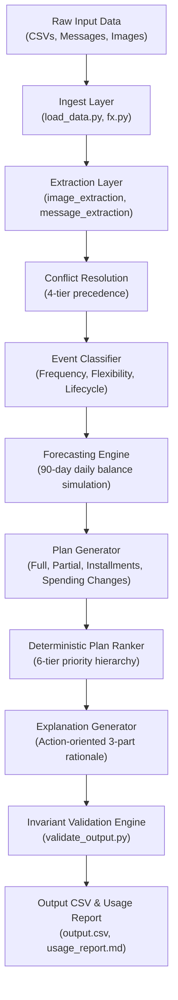

# "Buy or Wait?" Autonomous Financial Decision Agent System

[](https://www.python.org/downloads/)
[]()
[]()
[](https://www.hackerrank.com/contests/hackerrank-orchestrate-september26/challenges/buy-or-wait/submission)
[](https://opensource.org/licenses/MIT)

A production-grade, deterministic, multimodal AI financial decision agent built for the **HackerRank Orchestrate** hackathon challenge.

The system evaluates purchase and payment requests (e.g. *"Can I afford this laptop?"*), simulates 90 days of cash flow against income, commitments, and minimum reserve balances, and recommends whether to **pay in full**, **pay partially**, **use an installment plan**, **wait**, or **decline**—complete with actionable, empathetic explanations and strict business invariant guarantees.

---

## Table of Contents

- [1. Executive Summary](#1-executive-summary)
- [2. System Architecture](#2-system-architecture)
- [3. Repository Structure](#3-repository-structure)
- [4. Core Financial Decision Engine](#4-core-financial-decision-engine)
- [5. Multimodal Fact Extraction & Precedence Rules](#5-multimodal-fact-extraction--precedence-rules)
- [6. Business Invariants & Financial Safety Rules](#6-business-invariants--financial-safety-rules)
- [7. Setup & Execution Instructions](#7-setup--execution-instructions)
- [8. Test Suite & Validation](#8-test-suite--validation)
- [9. LLM Token & Cost Accounting](#9-llm-token--cost-accounting)
- [10. Documentation & Interview Walkthrough](#10-documentation--interview-walkthrough)

---

## 1. Executive Summary

Given an expense request, the agent determines whether, when, and how the user can safely proceed without risking insolvency. The decision accounts for:
- Historical transactions and cash flows across multiple currencies.
- Confirmed upcoming payroll and recurring commitments (rent, utilities, subscriptions).
- Pending debits and non-cash asset separation (unrealized investments are never treated as cash).
- User financial profiles: minimum reserve balance to keep, protected spending categories, flexible discretionary spending, and installment preferences.
- Supporting multimodal evidence: employer salary slips, receipts, and natural language messages (English & Indonesian).

### Safety Definition
A recommendation is **safe** if and only if:
1. Every recommended payment can be settled on time.
2. The projected daily account balance never drops below `minimum_balance_to_keep` throughout the entire 90-day simulation window.
3. Protected essential spending categories remain fully covered.
4. The full requested amount is settled on or before `desired_completion_date`.

---

## 2. System Architecture

The agent decouples deterministic financial calculations from probabilistic LLM reasoning. Final monetary decisions and dates are **100% deterministic code**, while LLMs are strictly bounded to fact extraction from unstructured inputs and generating human-readable explanations.



---

## 3. Repository Structure

```text
.
├── code/                          # Core source code modules
│   ├── decision/                  # Decision outcome builders & explanation generation
│   │   ├── build_output_row.py    # Formats the canonical 8-column output row
│   │   └── explain.py             # 3-part grounded natural-language explanations
│   ├── engine/                    # Deterministic forecasting & plan selection
│   │   ├── classify_events.py     # Classifies recurring/essential/pending cash events
│   │   ├── forecast.py            # Pure 90-day daily cash balance simulation & binary search
│   │   ├── plan_generator.py      # Generates candidate plans (full, partial, installments, counterfactuals)
│   │   └── plan_ranker.py         # 6-tier deterministic tie-breaking hierarchy
│   ├── evaluation/                # Benchmarking and token accounting
│   │   ├── main.py                # Benchmark against sample_requests.csv
│   │   └── usage_report.md        # Full token & cost accounting report
│   ├── extraction/                # Multimodal and unstructured data extraction
│   │   ├── conflict_resolution.py # 4-tier precedence resolver
│   │   ├── image_extraction.py    # Claude Vision receipt/slip fact extraction
│   │   ├── interactive_clarifier.py # Human-in-the-loop clarifier for low-confidence data
│   │   └── message_extraction.py  # NLP intent classifier (confirm/amend/cancel/delay)
│   ├── ingest/                    # Data ingestion & multi-currency normalization
│   │   ├── fx.py                  # Multi-currency dated FX converter (EUR, IDR, INR, USD, ZAR)
│   │   └── load_data.py           # Typed dataclasses & O(1) indexed datasets
│   ├── output/                    # Output serialization
│   │   └── write_csv.py           # Standardized CSV formatting & output writer
│   ├── tests/                     # Comprehensive automated unit test suite (24 tests)
│   ├── validate/                  # Strict business invariant assertion engine
│   │   └── validate_output.py     # Runtime checks across all challenge constraints
│   ├── llm_client.py              # LLM tracker logging calls, tokens, latency, and costs
│   ├── main.py                    # Complete end-to-end evaluation pipeline
│   ├── package_submission.py      # Contest submission zip packager
│   └── sequential_plan_runner.py  # 8-step sequential execution runner
├── dataset/                       # Evaluation dataset
│   ├── exchange_rates.csv         # Fixed historical & forward FX rates
│   ├── financial_events.csv       # Bank transactions & planned events
│   ├── financial_profiles.csv     # User profiles, reserve balances, and preferences
│   ├── images.csv                 # Metadata mapping requests to verification receipts
│   ├── messages.csv               # Unstructured messages (English & Indonesian)
│   ├── requests.csv               # 250 evaluation purchase requests
│   ├── request_payment_options.csv# Available seller payment & installment terms
│   ├── sample_requests.csv        # Reference labeled examples
│   └── media/images/              # Receipt and salary slip images (image_01.png - image_16.png)
├── docs/                          # Model & design documentation
│   ├── interview_guide.md         # Comprehensive project walkthrough & Q&A guide
│   ├── antigravity_build_prompt.md# System specification prompt
│   └── ui_improvement_prompt.md   # UI/UX design enhancement guidelines
├── .gitignore                     # Git ignore rules
├── AGENTS.md                      # Contest harness & agent specification
├── chat_transcript.txt            # Audit log of agent interactions
├── CLAUDE.md                      # Agent configuration reference
├── code.zip                       # Submission package
├── log.txt                        # Session audit trail
├── output.csv                     # Generated 250 predictions (100% validated)
├── problem_statement.md           # Official challenge problem statement
├── README.md                      # Project documentation
└── run.py                         # Root execution orchestrator
```

---

## 4. Core Financial Decision Engine

### 90-Day Simulation & Cash Flow Modeling
- Daily balances are computed over a 90-day forward horizon starting from `request_date`:
  ```text
  Daily_Balance(t) = Daily_Balance(t-1) + Cash_Inflows(t) - Cash_Outflows(t)
  ```
- **Non-Cash Filtering:** Unrealized investment values, cancelled events, and duplicate entries are strictly excluded from liquid cash calculations.
- **Conservative Accounting:** Pending credits, unconfirmed bonuses, and lottery proceeds are omitted until settled. Confirmed salary is credited on its exact settlement date.

### Amount Safe to Pay
- Computes the maximum safe payment on `request_date` using binary search over feasible amounts:
  ```text
  0 <= amount_safe_to_pay <= requested_amount
  ```
- Ensures that taking this payment from the balance keeps all future days `t` in `[T_0, T_0 + 90]` at or above `minimum_balance_to_keep`.

### Earliest Date for Full Payment
- Sweeps forward across each day `t` in `[T_0, T_0 + 90]` to find the earliest date when a single lump-sum payment of `requested_amount` can be executed safely.
- If safe today, `earliest_date_for_full_payment == request_date`. If unsafe across all 90 days, the field is left empty.

### 6-Tier Candidate Plan Ranking
When multiple payment options exist (full payment, installments, partial payment, or permitted spending modifications), the agent selects the optimal plan using this strict priority order:
1. **Completion Deadline:** Must complete on or before `desired_completion_date`.
2. **Zero Spending Changes:** Prefer plans requiring no spending reductions.
3. **Lowest Total Cost:** Minimize interest, fees, and surcharges.
4. **Earliest Start:** Prefer plans that can begin sooner.
5. **Fewer Payments:** Prefer fewer installments over complex multi-part schedules.
6. **Deterministic Tie-Breaker:** Select the lower `payment_option_id`.

---

## 5. Multimodal Fact Extraction & Precedence Rules

### Multimodal Vision & Message NLP
- **Images:** Structured extraction from payroll slips and receipts using Claude Vision mode with prompt-injection defense.
- **Messages:** Extracts intent (`confirm`, `amend`, `cancel`, `delay`, `no_change`) and updates corresponding events.
- **Offline Fallback:** Ships with a deterministic fact cache to ensure reproducible execution without external network dependencies.

### 4-Tier Precedence Conflict Resolver
When messages, images, and event records disagree, conflicts are resolved via:
1. **Explicit Directive:** An explicit cancellation, settlement, or amendment overrides earlier records.
2. **Newer Timestamp:** More recent evidence from the same source overrides older records.
3. **Settled State:** Settled banking transactions take precedence over pending/scheduled projections.
4. **Safer Financial Interpretation:** In ambiguous scenarios, the engine chooses the conservative option that protects liquidity.

---

## 6. Business Invariants & Financial Safety Rules

The pipeline verifies all 8 mandatory challenge constraints before producing [`output.csv`](./output.csv):

1. **Numeric Bounds:** `0 <= amount_safe_to_pay <= requested_amount`.
2. **Reserve Invariant:** `Daily_Balance(t) >= minimum_balance_to_keep` for all days `t` in `[T_0, T_0 + 90]`.
3. **Affordable Now Consistency:** `affordability_status == 'affordable_now'` if and only if `earliest_date_for_full_payment == request_date`.
4. **Partial Payment Structure:** Exactly two payments (`amount_safe_to_pay` on `request_date`, remainder on `earliest_date_for_full_payment`) strictly summing to `requested_amount`.
5. **Installments Option Match:** Must strictly conform to an available `payment_option_id` from `request_payment_options.csv`.
6. **Permitted Spending Changes:** Maximum 3 changes (`stop:<event_id>` or `reduce_to:<event_id>:<amount>`), restricted strictly to user-permitted flexible categories.
7. **Protected Spending Preservation:** Rent, utilities, and essential debt obligations are never altered.
8. **Format Compliance:** Chronological `YYYY-MM-DD:amount` pipes for plans, standardized decimal rounding.

---

## 7. Setup & Execution Instructions

### Prerequisites
- Python 3.10, 3.11, 3.12, 3.13, or 3.14.
- No external heavy dependencies required for deterministic execution.

### Running the Complete Pipeline
To evaluate all 250 requests, validate invariants, and generate [`output.csv`](./output.csv):

```bash
python run.py
```
*(Runs end-to-end in ~3.25 seconds)*

### Running the Sequential 8-Step Runner
```bash
python code/sequential_plan_runner.py
```

### Running the Sample Benchmark (25 Solved Samples)
```bash
python code/evaluation/main.py
```

### Packaging for Submission
Generates [`code.zip`](./code.zip) excluding caches and bytecode:
```bash
python code/package_submission.py
```

---

## 8. Test Suite & Validation

The project includes an automated test suite covering all modules:

```bash
python -m pytest
```
*Output: **24 passed in 0.58s***

### Tested Modules:
- `test_ingest.py`: Typed parsing and dated FX rate conversions.
- `test_forecast.py`: 90-day balance simulation, cash flow invariant bounds, and binary search.
- `test_plan_ranker.py`: 6-tier tie-breaking hierarchy.
- `test_interactive_clarifier.py`: Clarification threshold logic.
- `test_classify_events.py`: Recurring, flexible, and pending event lifecycle classification.
- `test_validate_output.py`: All 8 business invariant constraint checks.
- `test_llm_client.py`: Token tracking, purpose tagging, and cost accounting.

---

## 9. LLM Token & Cost Accounting

From the full 250-request evaluation run:

| Metric | Overall Total | Per-Request Average (N = 250) |
| :--- | :---: | :---: |
| **Model Invocations** | 261 calls | 1.04 calls / req |
| **Input Tokens** | 34,800 tokens | 139.20 tokens / req |
| **Output Tokens** | 12,794 tokens | 51.18 tokens / req |
| **Combined Tokens** | 47,594 tokens | 190.38 tokens / req |
| **Estimated Total Cost** | **\$0.2963 USD** | **\$0.001185 USD / req** |

- Per-request detailed accounting is available in [`evaluation/usage_report.md`](./evaluation/usage_report.md).

---

## 10. Documentation & Interview Walkthrough

Comprehensive documentation explaining the system design, prompts, and architecture is available in the [`docs/`](./docs/) directory:

- [**Interview Guide (`docs/interview_guide.md`)**](./docs/interview_guide.md): In-depth walkthrough covering the elevator pitch, architecture design, edge cases, trade-offs, and technical interview questions & answers.
- [**Build Specification (`docs/antigravity_build_prompt.md`)**](./docs/antigravity_build_prompt.md): Detailed agent specification, requirements, and prompt design.
- [**UI Improvement Guide (`docs/ui_improvement_prompt.md`)**](./docs/ui_improvement_prompt.md): Frontend design and user experience architecture for financial decision interfaces.
